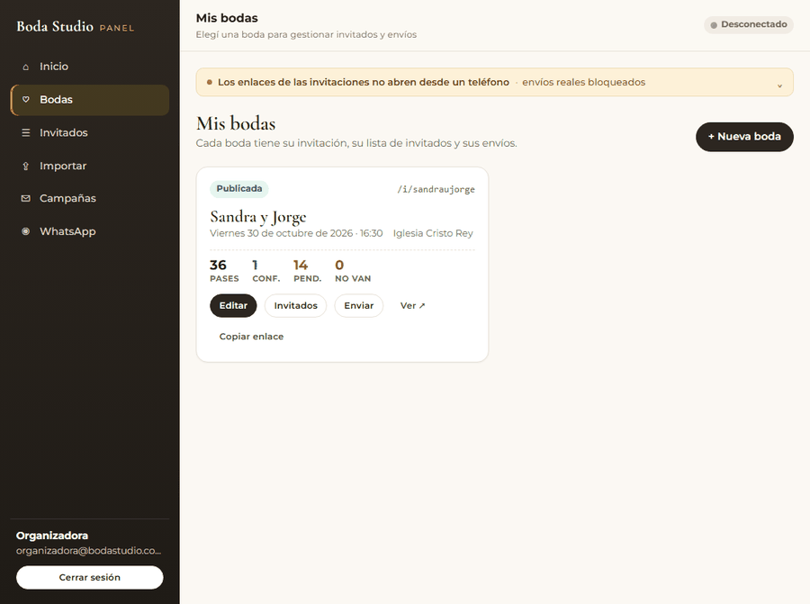
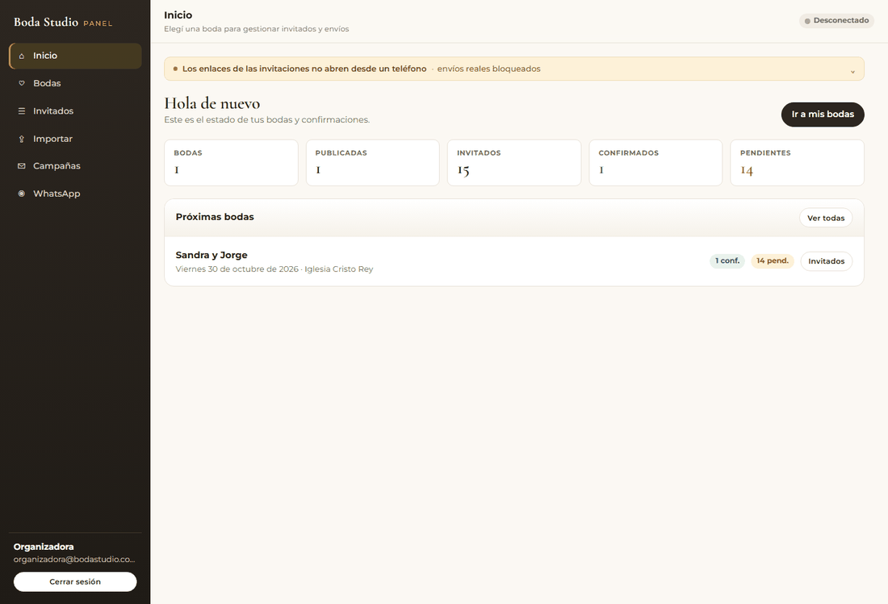
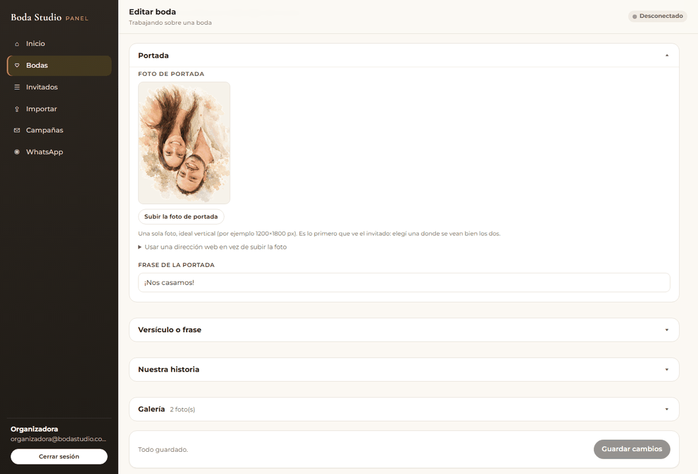
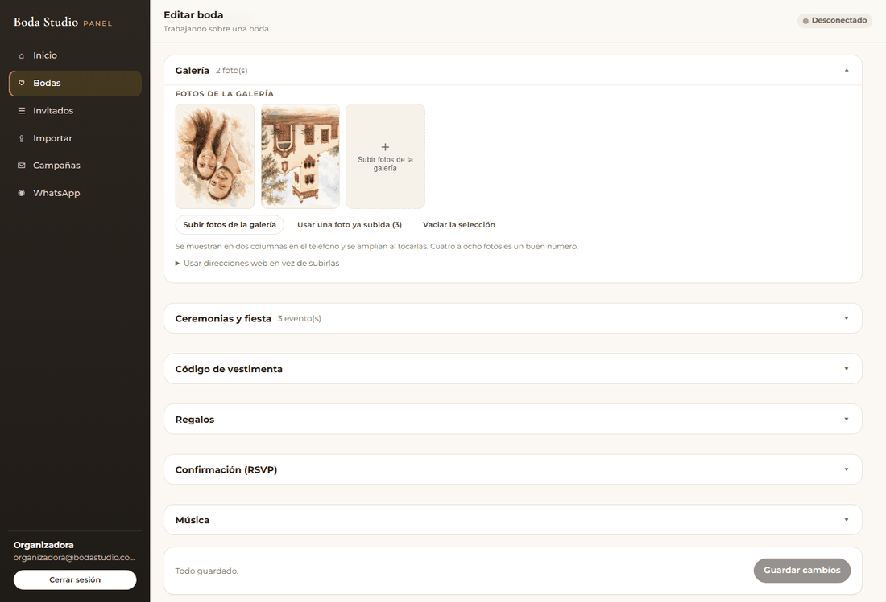
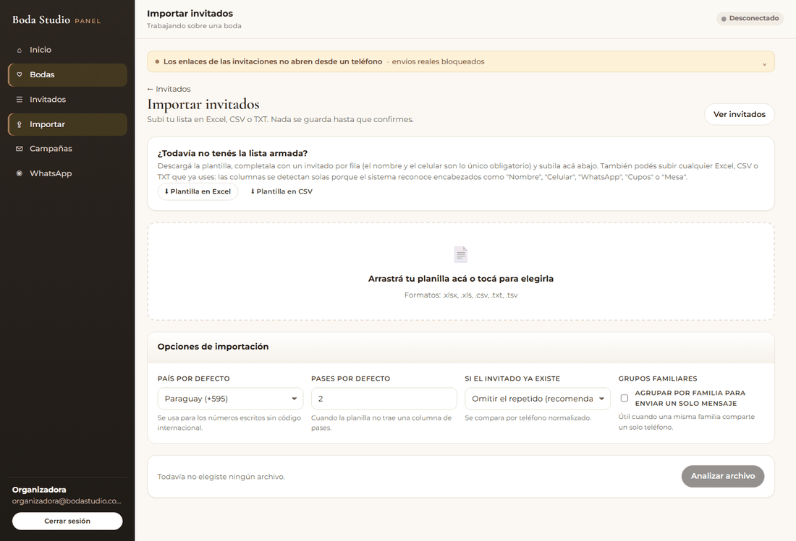
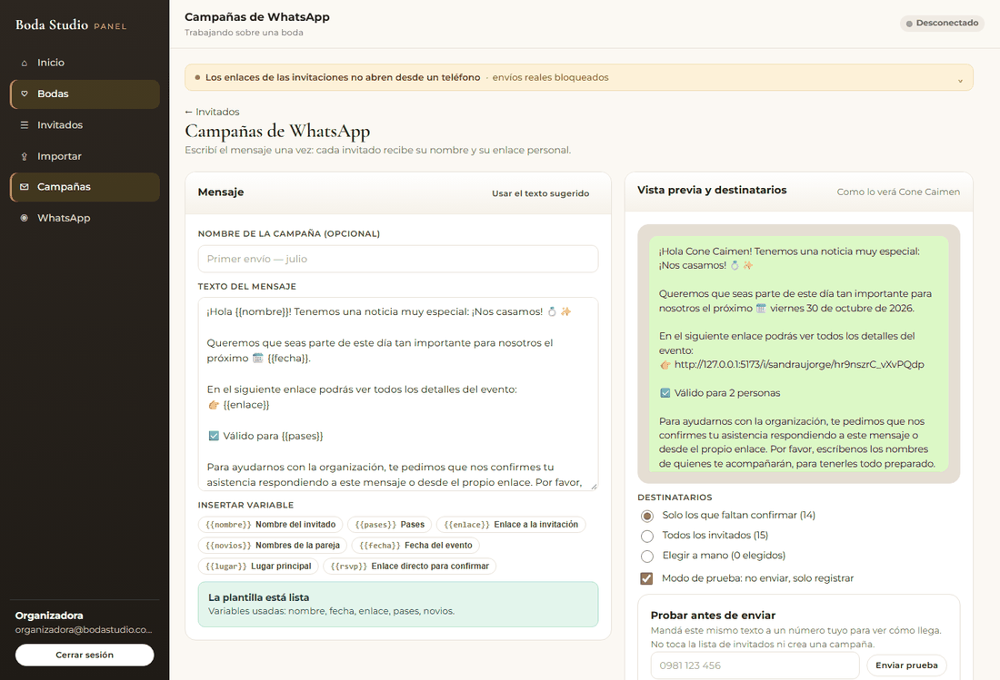
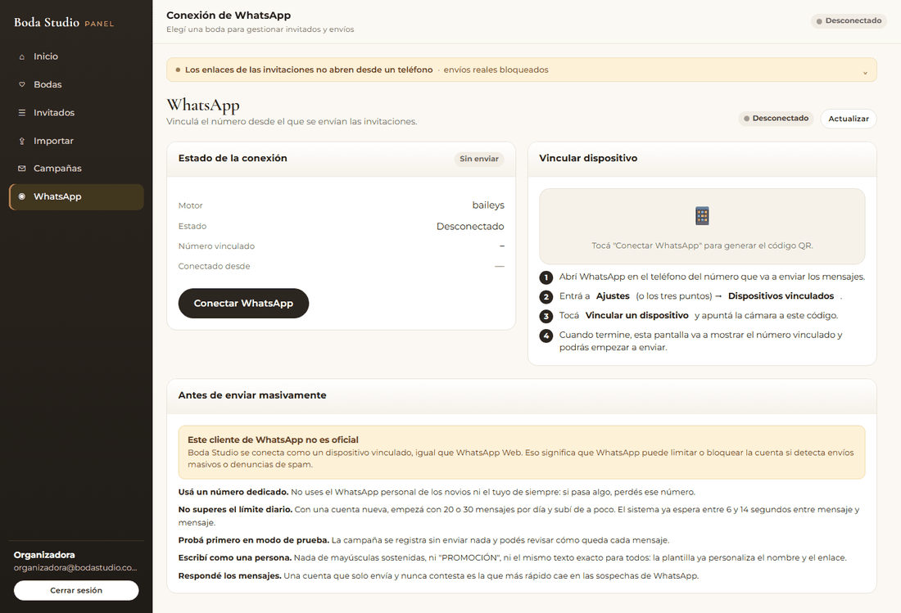
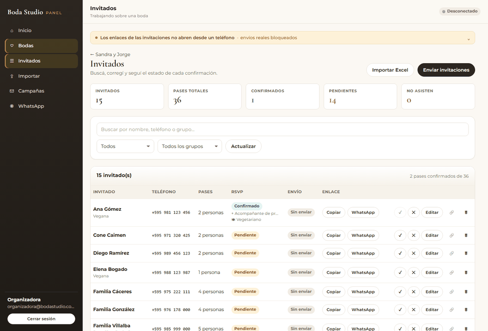

# 08 · Manual de la organizadora

Guía de uso del panel, sin tecnicismos. Para quien organiza la boda.

**Qué hace este sistema:** reemplaza la tarjeta PDF y el reenvío de WhatsApp uno por uno.
Cargás la lista de invitados, el sistema arma **un enlace personal para cada uno**, envía el
mensaje y después muestra quién confirmó, con cuántos pases y si tiene alguna restricción
alimentaria.

> ¿Buscás la guía de instalación? Esta no es. Esto es solo el uso diario del panel.

---

## 1. Antes de empezar

| Necesitás | Para qué |
|---|---|
| **Fotos de la pareja** | Portada y galería (JPG, PNG o WebP). Se suben desde el panel; no hace falta editarlas antes. |
| **La lista de invitados** | En Excel, CSV o TXT: nombre y teléfono por fila. |
| **Un chip de WhatsApp solo para el estudio** | Nunca tu número personal. |
| **Los datos del evento** | Fecha y hora, iglesia/salón, dress code, datos para regalos. |

**Prepará el chip con tiempo.** Que tenga el nombre del estudio y foto de perfil, y usalo unos
días de forma normal antes de la campaña: un número recién creado que manda 200 mensajes el
primer día es el que WhatsApp bloquea.

---

## 2. Entrar al panel

Abrí la dirección del panel (`https://tu-dominio/admin`) y entrá con el correo y la clave que te
dieron.



Si olvidaste la clave, pedila a quien administra el sistema: no se puede recuperar sola.

---

## 3. Crear la boda

**Bodas → Nueva boda.** Completá el nombre de la pareja y la **dirección web** (por ejemplo
`sandraujorge`); es la parte final del enlace que van a recibir los invitados.



> La dirección web conviene elegirla una sola vez. Si la cambiás después, **los enlaces que ya
> mandaste dejan de funcionar**.

La boda nace sin publicar: nada es visible en internet hasta que toques **Publicar**.

---

## 4. Cargar las fotos de la invitación

Esto es lo primero que ve el invitado, así que vale la pena dedicarle un rato.

Abrí la boda → panel **Portada**.



1. Tocá **Subir la foto de portada** (o arrastrá la foto al recuadro).
2. Elegí la imagen del teléfono o de la computadora. Se sube sola.
3. La foto vertical funciona mejor (por ejemplo 1200 × 1800 px). Una foto donde se vean bien
   los dos es mejor que una muy artística donde no se distingue quién es quién.

> **¿Cuánto puede pesar?** Hasta 8 MB por foto. El sistema acepta JPG, PNG y WebP. Si tu
> teléfono saca fotos **HEIC** (iPhone), cambialas a JPG antes de subirlas o mandátelas por
> WhatsApp a vos misma: llegan como JPG.

### La galería

Panel **Galería**. Es la sección «Nuestra galería» de la invitación: se ve en dos columnas y se
amplía al tocar cada foto.



| Botón | Qué hace |
|---|---|
| **Subir fotos de la galería** | Podés elegir varias a la vez (hasta 10). |
| **Usar una foto ya subida** | Abre la biblioteca: las fotos que ya subiste, para no subirlas dos veces. Tocala y se agrega. |
| **Quitar** (al pasar el mouse sobre una foto) | La saca de la invitación, pero **la foto queda guardada** en la biblioteca. |
| **🗑** (al pasar el mouse) | Borra la foto del servidor. Pide confirmación y no se puede deshacer. |
| **Vaciar la selección** | Deja la galería sin fotos. |

Cuatro a ocho fotos es un buen número. Más que eso tarda en cargar con datos móviles.

**Acordate de tocar «Guardar cambios»** abajo a la derecha: subir la foto la deja en el
servidor, pero recién con «Guardar» queda asociada a la invitación.

---

## 5. Completar el resto de la invitación

En la misma pantalla, panel por panel:

| Panel | Qué cargar |
|---|---|
| **Pareja y dirección** | Nombres, cómo se muestran juntos y la dirección web |
| **Portada** | Foto y frase corta («¡Nos casamos!») |
| **Versículo o frase** | La frase y de dónde es (por ejemplo Colosenses 3:14) |
| **Nuestra historia** | El relato y sus fotos (opcional) |
| **Galería** | Las fotos de la sección de galería |
| **Ceremonias y fiesta** | Una tarjeta por evento: **Boda Religiosa** (16:30, Iglesia Cristo Rey), **Boda Civil y Brindis** (19:00, Casa Ardissone)… Marcá la principal, que es la que usa la cuenta regresiva |
| **Código de vestimenta** | Texto y paleta de colores sugerida |
| **Regalos** | Mensaje, cuentas bancarias o «el mejor regalo es tu presencia» |
| **Confirmación (RSVP)** | Fecha límite, WhatsApp de contacto y qué preguntar (acompañantes, restricciones) |
| **Música** | Enlace a la canción y si querés que suene sola |
| **Secciones** | Activar, desactivar y **ordenar** cada bloque |
| **Tema** | Estilo general y colores |

Arriba de todo hay un botón **Ver invitación**: ábrelo para revisar cómo la va a ver el invitado.

---

## 6. Ver la invitación como la ve el invitado


Lo que ve el invitado es la misma invitación para todos, más un saludo con **su nombre** y
**sus pases** cuando entra con su enlace personal.


Revisala **desde un celular de verdad**, no solo en la computadora. Es la única forma de ver lo
que va a ver el invitado.

---

## 7. Importar los invitados

**Importar invitados**. Primero prepará el archivo: una fila por invitación, con **nombre** y
**teléfono**. Si querés, agregá **pases**, **grupo** y **notas**. Si no tenés la planilla, bajá
la **plantilla** desde el mismo panel.



1. Arrastrá el archivo (Excel, CSV o TXT).
2. Elegí el **país de los teléfonos** y cuántos **pases** dar por defecto.
3. Revisá la previsualización:

   | Color | Qué significa |
   |---|---|
   | **Verde** | Fila válida: se importa. |
   | **Amarillo** | Se importa, pero conviene mirar (por ejemplo, teléfono repetido). |
   | **Rojo** | No se importa. El motivo está escrito al lado; casi siempre es un teléfono incompleto. |

4. Si alguna columna no se reconoció, corregila en el mapeo y volvé a mirar.
5. **Confirmar importación**. Nada se guarda hasta este paso.

La primera vez, probá con un archivo de tres personas.

---

## 8. Escribir el mensaje y probarlo

**Campañas**. El mensaje ya viene escrito; podés cambiarlo y usar estas etiquetas:

```
¡Hola {{nombre}}! Tenemos una noticia muy especial…
👉 {{enlace}}
✅ Válido para {{pases}}
```

| Etiqueta | Se reemplaza por |
|---|---|
| `{{nombre}}` | Ana Gómez |
| `{{pases}}` | 2 personas (o 1 persona) |
| `{{enlace}}` | El enlace personal de ese invitado |
| `{{novios}}` | Sandra y Jorge |
| `{{fecha}}` | viernes 30 de octubre de 2026 |
| `{{lugar}}` | Iglesia Cristo Rey, Asunción |
| `{{rsvp}}` | El enlace, directo al formulario de confirmación |



A la derecha ves **cómo le queda el mensaje a un invitado real**.

---

## 9. Conectar WhatsApp

1. **WhatsApp → Conectar**. Aparece un código QR.
2. En el chip dedicado: WhatsApp → **Dispositivos vinculados** → **Vincular dispositivo** →
   escaneá.
3. El panel pasa a **Conectado** con el número.



La conexión queda guardada: no hay que escanear de nuevo cada día. Si aparece **Desconectado**,
volvé a conectar; las campañas no se pierden.

---

## 10. Enviar: siempre en tres pasos

| Paso | Qué manda | Cuándo |
|---|---|---|
| **1. Modo de prueba** (viene activado) | Nada: genera el texto de todos los mensajes y lo registra | Siempre, antes de cualquier envío |
| **2. Enviar prueba** (a tu número) | Un mensaje real, solo a ese número | Después de conectar el WhatsApp |
| **3. Campaña real** | Un mensaje por invitado, con pausas | Cuando viste las dos anteriores |

**No apures el envío.** Los retardos entre mensajes (6 a 14 segundos) son lo que protege el
número. Una lista de 200 invitados tarda cerca de hora y media: es normal y está bien.
El panel pausa solo si se llega al tope diario (250) y continúa al día siguiente, o cuando vos
tocás **Pausar**. Se puede reanudar sin repetir mensajes ya enviados.

---

## 11. Seguir las confirmaciones

**Invitados** muestra, de cada uno:

- **Confirmado / Pendiente / No asiste**.
- Los **pases** (lo que pide el salón).
- Los **nombres de los acompañantes** que escribió.
- Las **restricciones alimentarias**.
- Si recibió el mensaje y si no (**Sin enviar**, **Enviado**, **Fallido**).
- Botones para **Copiar** el enlace, abrir **WhatsApp** con el mensaje listo, marcar ✓ / ✕ o
  **Editar** sus datos.



Para apurar a los que faltan: nueva **campaña** solo a los pendientes, con un mensaje más corto
(«¡Hola {{nombre}}! Todavía no nos confirmaste…»).

---

## 12. Después de la boda

1. Exportá la lista de invitados desde **Invitados** (o sacá una captura de los totales).
2. Guardá el archivo en un lugar seguro.
3. **Borrá los invitados** de esa boda: son datos personales de terceros y no hace falta
   conservarlos después del evento.

---

## 13. ¿Qué hago si…?

| Situación | Qué hacer |
|---|---|
| Un invitado dice que no le llegó | Buscalo en **Invitados**, revisá el teléfono y el estado del mensaje; corregilo y hacé una campaña solo para él |
| Perdió su enlace | **Copiar** al lado de su nombre y reenviáselo |
| Cambió la hora o el lugar | Editá la boda en **Configuración**. Todos los enlaces muestran la versión nueva; avisá por WhatsApp |
| Pide no recibir más | Editalo y marcalo como que **no asiste**; no se le vuelve a escribir |
| WhatsApp aparece **Desconectado** | Reconectá con el QR. Las campañas no se pierden |
| Confirmó pero no aparece | Pedile que use **su** enlace. También podés marcarlo confirmado a mano |
| Una foto no sube | Revisá que sea JPG, PNG o WebP y que pese menos de 8 MB. Si es HEIC, convertila |
| El panel muestra un aviso amarillo arriba | Significa que los enlaces todavía apuntan a tu computadora y **no van a abrir en el celular de los invitados**. Avisale a quien administra el sistema: es un ajuste de configuración, no un error tuyo |

---

## 14. Palabras que vas a ver

| Palabra | Qué significa |
|---|---|
| **Pases** | Cuántas personas entran con esa invitación (2 pases = la pareja). |
| **RSVP** | La confirmación de asistencia. |
| **Modo de prueba** | Envío simulado: muestra los textos pero no manda nada. |
| **Borrador / Publicada** | Una boda en borrador no se ve en internet; publicada sí. |
| **Dirección web (slug)** | La parte final del enlace: `sandraujorge` en `/i/sandraujorge`. |

---

## 15. Lo que hay que cuidar

- **Un chip dedicado**, nunca tu número personal.
- **No bajes los retardos** entre mensajes ni subas el tope diario por tu cuenta.
- **Probá siempre en modo de prueba** antes de la campaña real.
- **Respondé** los mensajes que lleguen: un número que solo emite parece un bot.
- **No compartas** la lista de invitados: son datos personales de otras personas.
